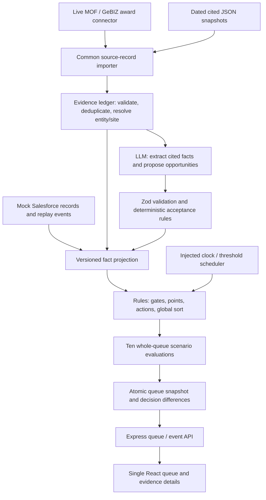

# Singtel Enterprise lead-ranking agent: implementation plan

Implementation update: the local demo is now built. See [delivery notes](lead-ranking-delivery.md) and the root README for executed commands and the current file-store architecture. The original specification below remains the design baseline.

Planning baseline: `Lead-Ranking-Agent`, commit `da340d5`, inspected 15 November 2026.
This delivery specifies the build; it does not claim the ranking app is implemented.
The executable work delivered now is a read-only GeBIZ connector spike with a saved live result.

Related deliverables: [data contracts](lead-ranking-contracts.md), [source inventory](lead-ranking-sources.md),
[demo script](lead-ranking-demo.md), [enterprise design rationale and evidence](lead-ranking-enterprise-evidence.md).

## Product contract

Return one ordered opportunity queue on every successful read. The unit is
**account x buying unit/site x product/use case x buying window**, never just a parent-company score.
An ETLA new-facility managed connection and its existing-site WAN renewal are distinct opportunities;
two mirrors of the same facility announcement are one trigger.

Demo scope: 16 opportunities: eight managed connectivity renewals, seven new-site connections,
and one private 5G hypothesis. All Salesforce relationships, contacts, contracts, commercial estimates,
service cases, engineering assessments and precise purchase dates are explicitly **synthetic CRM facts**.
Public sources establish only the claims they actually contain. A sourced facility expansion does not
establish a Singtel relationship, buying intent, available fibre, contract expiry or a private 5G requirement.

The priority score is a transparent proxy for the value of acting now, on a 0-100 scale.
Ranking confidence is a separate 0-100 measure of stability across ten specified scenarios.
Neither is a calibrated win probability or a claimed enterprise outcome.

## Workspace findings and reuse

| Existing file or area | Finding | Planned change |
| --- | --- | --- |
| `backend/src/models/Opportunity.ts` | Company-level service/reasoning; static HIGH/MEDIUM/LOW; OPEN/IN_PROGRESS/CLOSED; unexplained 0-1 confidence | Add a separate versioned ranking projection and explicit opportunity identity; do not reinterpret old confidence values |
| `backend/src/models/IntelligenceSignal.ts`, `DataSource.ts` | URLs and timestamps exist, but no claim ledger, site match, excerpt or gate proof | Introduce immutable evidence records and freshness policies |
| `backend/src/repositories/opportunityRepository.ts` | Alphabetical priority sort before a created-time tiebreak; no numeric rules | Rank the full eligible dataset in application code before returning rows |
| `frontend/src/pages/OpportunityIntelligence.tsx` | Existing table, filters, badges and empty/error components | Reuse the page as the single queue; add inline evidence details and replay controls |
| `frontend/src/services/opportunities.service.ts` | Catch-all API failure substitutes five unrelated mock rows | Replace for the new queue with last successful version and explicit degraded state |
| `frontend/src/utils/formatters.ts` | `formatConfidence` multiplies a 0-1 value by 100 | Add a distinct formatter for nullable 0-100 ranking/action stability; do not multiply twice |
| `backend/src/scripts/seed.ts` | Five fictional companies across APAC | Add an isolated, versioned Singtel demo seed; do not run the existing destructive seed against other data |
| Packages and infrastructure | Express/TypeScript, Zod, Mongoose; React/Vite/Tailwind; MongoDB and Neo4j | Keep this stack. MongoDB holds authoritative facts and queue snapshots; graph visualization is optional |
| `backend/src/scripts/verify-api.ts` | Counts any HTTP response as a pass, including failures; no ranking assertions | Add real domain/API/browser assertions and proper nonzero exits |
| Build/tooling | No committed dependency lockfiles, test script or CI workflow observed | Select one package manager, commit lockfiles, add scoped checks when implementation starts |

No repository `AGENTS.md` was present. No existing application code was changed for this planning delivery.

## Architecture and boundaries

The LLM receives allowlisted source text and entity candidates, returns schema-constrained claims with
source spans plus suggested account/unit/product/window tuples, and may explain facts. It never assigns
points, gates, confidence or final ranks. Store model/prompt version and extraction output; replay cached
extractions in the demo so network/model variance cannot alter a judge's run. A failed extraction leaves
the last accepted facts intact. An unsupported fact is a proposal requiring verification, not an observation.

Use a small deterministic state machine and pure TypeScript functions, not a multi-agent orchestration
framework. Cache ingestions and calculations by input fingerprint. No real Salesforce account is needed;
the adapter consumes local Salesforce-shaped records. No automated outreach or live CRM writes are in scope.

Persist raw references, immutable normalized evidence, CRM events, current projections and queue snapshots.
Neo4j may receive derived entity edges, but graph availability must not determine whether the queue renders.
Use a serial demo reducer plus a unique event index and optimistic projection revision; do not require
MongoDB multi-document transactions on the current standalone Compose database. Publish each full queue
as one atomic document, with a recoverable event cursor and revision check.

## Deterministic scoring rubric v1

Our starting assumptions, not weights taken from an enterprise case. Sum integers; no stochastic scoring,
per-company size bonus or LLM-generated weights. Missing evidence earns zero for that feature, with its
unknown state preserved for gates and scenarios. No double counting of mirrored announcements.

| Component | Maximum | Explicit points |
| --- | ---: | --- |
| Need and timing | 35 | Need: 15 for a specific sourced facility/operational trigger or synthetic active contract requiring renewal; 8 for a supported but nonspecific operating need; 0 otherwise. Take the strongest supported need once. Timing: 20 for a required action deadline in `(now, now+7d]`; 16 in `(7d,30d]`; 10 in `(30d,90d]`; 5 in `(90d,180d]`; 0 beyond 180d, unknown, or expired |
| Product fit | 25 | Use case: 10 direct connectivity requirement, 5 plausible adjacent use case, 0 mismatch. Catalog: 5 if in the sourced Singtel capability catalog, else 0. Fulfilment: 5 each for current PASS site and mandatory-technical checks; UNKNOWN/FAIL gets 0 |
| Buyer readiness | 20 | 5 for a named synthetic buying-unit contact; 7 for relevant two-way activity in the last 30d; 8 for a confirmed buying window from an authoritative contract/notice or synthetic buyer confirmation |
| Contribution | 15 | Estimated annual gross contribution in SGD: >=50,000 = 15; [20,000,50,000) = 10; [5,000,20,000) = 5; [0,5,000) = 0; unknown = 0. Store assumption/range. Do not treat a tender's award amount as our contribution |
| Pursuit effort | 5 | Remaining pursuit hours: [0,8] = 5; (8,24] = 3; >24 = 0; unknown = 0. This is effort efficiency, so higher points mean less work |
| **Total** | **100** | Clamp invalid inputs at validation, not silently during scoring; negative amounts/hours are rejected |

Dates use exact elapsed time in UTC internally; render Asia/Singapore. Date-only procurement records keep
date precision. Do not invent a closing hour: an unknown mandatory closing time is Verify until resolved.
Only the earliest applicable **required next-action** deadline drives timing. Keep contract end, notice date,
bid close, site ready-by and the rep task due time as separate fields. An award's date is not a timing deadline.

Sort by `(queueTier ASC, score DESC, requiredDeadline ASC NULLS LAST, canonicalOpportunityId ASC)`.
Tier 0 includes Pursue, Verify and Resolve; tier 1 is Monitor; tier 2 is Blocked. Within tier 0 a useful
verification or service-resolution task can outrank a sales call. Stable canonical IDs are opaque fixed
fixture IDs / hashes of business identity, never database insertion timestamps. Rank the whole queue before
pagination or display filtering. Movement compares the previous committed generation in the same view;
new rows show NEW, unchanged rows show 0, and removals remain in the decision audit.

Examples (fully synthetic commercial inputs):

| Opportunity state | Need/timing | Fit | Readiness | Contribution | Effort | Total / decision |
| --- | ---: | ---: | ---: | ---: | ---: | --- |
| ETLA new-site trigger, no confirmed purchase date, site disputed, technical PASS | 15 | 20 | 5 | 10 | 3 | **53 / Verify** |
| Same tuple; CRM confirms order notice in eight days and recent buyer activity | 31 | 20 | 20 | 10 | 3 | **84 / Verify** |
| Same tuple; engineering confirms serviceability and ready-by feasibility | 31 | 25 | 20 | 10 | 3 | **89 / Pursue** |
| Large private 5G hypothesis; adjacent use case, RF test UNKNOWN, expensive pursuit | 25 | 15 | 5 | 15 | 0 | **60 / Verify**, even if its deal amount is the largest |

## Fulfilment, procurement and next actions

Evaluate these three gates independently, returning PASS / UNKNOWN / FAIL plus the exact predicate and
evidence IDs. Preserve all reasons even when one reason determines the displayed status.

| Gate | Connectivity renewal / new site | Private 5G candidate |
| --- | --- | --- |
| Site serviceability | Exact premises, install access and deliverable service by required ready-by. A building postcode alone is insufficient; renewal uses a current validated circuit assessment | Surveyed coverage/installation access for the exact zone and delivery date; a macro 5G coverage map is insufficient |
| Mandatory technical condition | Synthetic requirement: two physically diverse access paths, supported by a mock route assessment; two circuits in one duct FAIL | Synthetic requirement: measured p95 round-trip latency <=20 ms for the target AGV zone; unmeasured latency UNKNOWN, measured 28 ms FAIL. This is our demo threshold, not a Singtel SLA |
| Procurement / notice deadline | Required bid or contractual notice date is known, future, and the specific mandatory submission condition is satisfied | Same check, using the synthetic evaluation/pilot deadline |

Use sourced notice/contract requirements when actually accessible, with page/section proof. The inspected
GeBIZ notice exposes its close date but its technical attachments require login; it is not evidence of a
redundancy obligation. The demo's redundancy and private 5G latency requirements remain explicitly mock.
IMDA resilience guidance and Singtel marketing material are context, not customer-specific gate passes.

Status precedence:

1. Any confirmed mandatory FAIL -> **Blocked**. Action names the failed condition and remediation owner.
2. Otherwise any UNKNOWN, disputed match or stale mandatory assessment -> **Verify**. Action asks for the
   decisive missing fact, with assigned owner and due time. A confident LLM extraction cannot pass a gate.
3. Otherwise a relevant unresolved blocking service case -> **Resolve** before commercial outreach.
4. Otherwise no current actionable buying window (e.g. >90d away) -> **Monitor** with a scheduled review.
5. Otherwise -> **Pursue**, with a specific offer/discovery or renewal action, owner and deadline.

An incomplete evidence record is not a confirmed failure. A missed deadline is FAIL only when an
explicit mandatory rule makes the opportunity infeasible; an expired notice cannot be silently reopened.
For a case or engineering event, update affected facts first, then run gates, score, actions, global sort and
confidence together. A service issue changes the action without arbitrarily increasing the sales score.

Task deadlines: Pursue = earlier of next business day and required deadline; Verify = earlier of now+24h
and required deadline; Resolve = case SLA due; Monitor = earlier of now+7d and entry to the 90d window;
Blocked = remediation review in seven days, while showing the missed procurement deadline separately.
Use a seeded business calendar (Singapore weekdays; explicitly add holidays if needed), never hide past due tasks.

## Ranking confidence: scenario stability v1

Capacity is **five working opportunities this week**. Priority bands are WORK_NOW (first five tier-0 rows),
NEXT (remaining tier-0 rows), WAITING (Monitor), BLOCKED (Blocked). Status and priority band are separate.
For each of ten named, equally counted stress scenarios, apply overrides to the **same full queue**, run
the complete pipeline including gates and tiebreaks, then record every opportunity's rank, band and action.

`rankingConfidence = 100 * count(scenarioBand === displayedBand) / 10`

`actionConfidence = 100 * count(scenarioActionCode === displayedActionCode) / 10`

Show `80/100: retained WORK_NOW in 8 of 10 scenarios`, plausible min-max rank, action stability and
`verifyNext` (fact, owner, value of resolving it). Exact action-code equality ignores incidental wording.
Include the displayed baseline as S0. These are stress scenarios, not estimated frequencies of reality.
Do not use percentages from LLM certainty or legacy `confidenceScore` as scenario confidence.

Ten fixed worlds, version `scenario-v1` (unlisted facts use the displayed state):

| ID | Disputed ETLA site | Shared estimates across all affected rows | Other decisive uncertainty |
| --- | --- | --- | --- |
| S0 | UNKNOWN | Contribution x1.0; effort x1.0; new-site install lead 30d | Displayed baseline |
| S1 | PASS | Same | Optimistic site assessment |
| S2 | PASS | Contribution x0.8 on all estimated contributions | Conservative commercial estimate |
| S3 | PASS | Contribution x1.2 on all estimated contributions | Higher contribution estimate |
| S4 | FAIL | Base | Survey finds no feasible service by ready-by |
| S5 | FAIL | Effort x1.25 on all estimated pursuit hours | Failed site plus more pursuit work |
| S6 | UNKNOWN | Effort x0.75 on all estimated pursuit hours | Less pursuit work |
| S7 | PASS | Install lead 45d for **every** new-site row | Shared delivery constraint |
| S8 | UNKNOWN | Base | UMC new-site technical assessment PASS |
| S9 | PASS | Base | Customs renewal notice resolves to the earlier documented alternative |

All alternatives need an assumption record with rationale, evidence IDs, bounds, affected IDs and a
resolution rule. For O01, synthetic ready-by is 15 February 2027, safely beyond both install bounds.
Shared factors must change every linked estimate in that world. Never vary sibling facts independently
when they represent the same site assessment, contract or supplier lead-time constraint.

Once ETLA's site is verified PASS, project PASS into **all ten worlds**; retain the scenario IDs and
other variations. Do not retain resolved false states or select a new sample to manufacture confidence.
O01's target golden behavior is 84 / rank 3 / Verify / 80 ranking confidence / 30 action confidence before
verification, then 89 / rank 1 / Pursue / 100 / 100 after it. The seed and automated assertions must confirm
these numbers using the whole queue; see the demo script. Plausible rank bounds are calculated, not typed
into the UI. If implementation changes the rubric, update the fixture version and golden assertions together.

If a decisive input has no defensible plausible bound, show **Insufficient evidence**, with null numeric
confidence and an explicit missing-assumption reason. Propagate this to any other row whose band could
change because of that unbounded competitor. Still show a number for provably unaffected bands (e.g.
an independently failed mandatory gate stays BLOCKED). Do not discard an uncertain competitor from the
scenario queue to inflate another lead's confidence. Score/rank remain available from conservative displayed
inputs, with their limitations visible. A confidence score of 0 is valid and differs from null.

## Events, timing and reliable refresh

Use append-only mock Salesforce events: `RenewalNoticeConfirmed`, `BuyingWindowConfirmed`,
`ServiceCaseOpened`, `ServiceCaseResolved`, `SiteAssessmentCompleted`, plus `PublicTriggerImported`
and an explicit `ClockAdvanced`. Every replay has a fixed event ID, affected aggregate ID, aggregate
version, effective time, ingestion time and evidence links. A duplicate ID returns the existing result.
A reused ID with a different payload is rejected (409). Order by aggregate version; hold/reject gaps or
older conflicting changes rather than overwriting current facts. Seed reset creates an isolated run namespace.

Schedule recalculation at exact 180/90/30/7-day timing boundaries, expiry, activity age 30d, assessment
expiry and Monitor review deadlines. Inject a clock into all domain functions; no implicit `Date.now()`.
A no-op event/refresh returns the same rows, version and movement. Deduplicate announcements by canonical
document/claim fingerprint, not merely by hostname. Compute each generation once and publish atomically.

Source refresh semantics:

- Success: normalize and validate the complete staged response, then merge accepted evidence and publish
  a new queue only if the decision fingerprint changes. Distinguish `sourceCheckedAt` from `queueComputedAt`.
- Source timeout, 429, 5xx or schema drift: retain the **last successful queue**, version and computed time;
  return it with degraded source health and attempt time. Never substitute unrelated mocks or remove rows.
- A later CRM/clock event can independently commit a valid generation against last accepted public facts,
  respecting stale-fact rules. A failed public refresh itself is never a successful queue generation.
- First start: load the bundled dated snapshot seed before enabling the queue. If initialization fails and
  no last-successful snapshot exists, return `items: []`, `initialized: false`, `degraded: true`, not a misleading
  successful empty state. A genuinely initialized zero-opportunity dataset returns `items: []`, total 0, healthy.

## Fair comparisons and source contribution

Use one seeded opportunity universe and CRM event cursor for all views. Toggle the same table between
`crm_only`, `crm_plus_public`, and `deal_value`. The CRM-only view keeps public-discovered IDs in the
comparison universe, marked as absent from the original CRM discovery set, with public-derived fields
removed. Recompute their status normally: an unknown mandatory gate still means Verify. Do not let them
inherit an extracted site/date/need through a shared cache. Preserve explicitly seeded CRM facts and the
shared catalog/rubric reference data. After E1, O01 has the confirmed mock window but loses the public
need contribution in CRM-only, so it falls below the top five. Do not force it to Monitor to exaggerate lift.

Show rank/status/score deltas and the particular evidence IDs responsible for each changed feature or gate.
The deal-value baseline sorts the same 16 IDs by synthetic estimated annual contract value descending,
ID ascending, without hiding failed gates. Keep gate/status badges so its false priorities are visible.
Report top-five overlap, newly discoverable opportunities, feasible Pursue count in top five, and relevant
Verify/Resolve tasks in top five. These are fixture diagnostics, not measured sales lift or predictive accuracy.

For each source family, run leave-one-family-out on the same frozen facts and same rubric/scenarios.
Keep all syndicated versions of one announcement in a **single provenance group**, so removing EDB while
retaining its identical JTC copy does not pretend to test independent evidence. Report also physical family
coverage separately. A shared announcement adds zero extra need points. Product pages can establish
catalog fit but never a customer's demand or serviceability.

## Build order and first files

Effort estimates are developer-days for this repository, to refine after the first vertical slice.

| Stage | First files to add/change | Acceptance before continuing |
| --- | --- | --- |
| 1. Contracts, seed and clock (0.5-1d) | `backend/src/ranking/contracts.ts`, `backend/src/ranking/clock.ts`, `backend/src/fixtures/lead-ranking/{crm,opportunities,events,assumptions}.json`, `backend/src/scripts/seed-lead-ranking.ts` | Zod schemas reject invalid IDs/dates; exactly 16 unique tuples; synthetic labels survive API serialization; isolated reset is repeatable |
| 2. Pure decision engine (1d) | `backend/src/ranking/{rubric,gates,actions,rank,confidence}.ts`, `backend/src/ranking/__tests__/decision.test.ts` | Tables, boundary cases, stable sort, correlated scenarios and disputed-then-verified confidence goldens pass |
| 3. Source importer (1d) | `backend/src/integrations/public/{contracts,importer,gebiz,snapshot}.ts`, `backend/src/ranking/{entityMatch,provenance}.ts` | Promote verified spike; pagination/schema/timeout behavior works; dated snapshots use same importer; duplicates add no points; ambiguous matches yield Verify |
| 4. CRM event reducer and persistence (1d) | `backend/src/integrations/salesforce/{mockAdapter,reducer}.ts`, `backend/src/models/{Evidence,RankingSnapshot,CrmEvent}.ts`, `backend/src/services/rankingService.ts` | Idempotent events, atomic generations, stale-source behavior and no-op fingerprint assertions pass |
| 5. API (0.5d) | `backend/src/routes/ranking.routes.ts`, `backend/src/controllers/rankingController.ts`, route registration | Queue always has an array; replay/clock/reset produce audited differences; baseline views share exact IDs |
| 6. Single queue UI (1d) | Change `frontend/src/pages/OpportunityIntelligence.tsx`; add `frontend/src/components/ranking/{QueueRow,EvidenceDetails,ReplayControls}.tsx`, `frontend/src/services/ranking.service.ts`, `frontend/src/hooks/useRankingQueue.ts` | Rank, movement, tuple, status, action, owner, deadline, strongest evidence and numeric/null confidence all render; keyboard-accessible details and replay |
| 7. Demo checks and documentation (0.5-1d) | `backend/src/scripts/verify-ranking-demo.ts`, API tests, `frontend/e2e/lead-ranking.spec.ts`, lockfiles, README | All readiness checks below pass; dry run completes within seven minutes with network disabled after initialization |

The delivered `tools/gebiz-connector.mjs` and `docs/evidence/gebiz-live-verification.json` are the starting
point for stage 3. The common production importer, LLM adapter and queue are still to be built.

## Feature acceptance and demo readiness

| Check | Observable pass condition |
| --- | --- |
| Granularity | Distinct ETLA renewal, new site and 5G rows share a parent but keep unit/site, product and window; mirrors cannot create a fourth row |
| Score explainability | Component totals reproduce 53 -> 84 -> 89; rubric version and contributing fact IDs visible; sum is <=100 |
| Live connector | Saved probe contains successful HTTP requests, complete pagination, 11 normalized awards at verification time; rerun validates current schema rather than assuming count stays 11 |
| Source coverage | Inventory includes every required family; committed snapshots have exact URL/date/locator/excerpt and claim status; all pass one normalized importer schema |
| Public discovery | Import SGX/EDB ETLA trigger once -> O01 appears; same import again -> no count/score/version change |
| CRM action | Confirm synthetic window -> O01 enters top five with recorded old/new action and evidence; case event -> Resolve; case resolved -> previous commercial action |
| Gates | Unknown mandatory fact -> Verify; failed site, failed redundancy and missed required deadline independently -> Blocked; all PASS -> Pursue when current window exists |
| Private 5G | WAN serviceability cannot pass RF/latency requirement; a 28ms assessment blocks a <=20ms requirement, an unmeasured test verifies |
| Confidence | Ten whole-queue worlds reproduce 8/10 and 10/10 retention; shared overrides affect all linked IDs; min/max rank and action confidence match calculated results |
| Unbounded facts | Insufficient evidence uses null, does not become 0 or fabricated 100; potentially displaced competitors lose unsupported confidence too |
| Events | Replay twice has identical row arrays and hashes; duplicate event no-op; conflicting duplicate or out-of-order version rejected without partial queue updates |
| Entity ambiguity | Same-name synthetic subsidiary matches two candidates -> retained Verify task, no automatic merger or inherited parent deadlines |
| Staleness | Expired assessment becomes UNKNOWN and Verify; an old award stays historical context and never becomes a current renewal; old news cannot create fresh urgency on retrieval |
| Failure recovery | Inject timeout/429/invalid response mid-page -> exact last successful rows/version/time returned, degraded badge; successful retry updates health without invented movement |
| Empty queue | Reset to empty fixture -> healthy initialized `items: []`, no fallback mock rows; failed initialization has a distinct degraded/uninitialized state |
| Clock | Freeze T0; test exactly 7/30/90/180 days, notice expiry, task due and age thresholds; each relevant crossing triggers once |
| Comparison | Same 16 IDs, pinned cursor and clock; source-family ablation has no mirrored-source leakage; deal-value sort visibly retains a large blocked/Verify candidate |
| UI/API checks | Domain tests assert exact decisions; API tests reject 4xx/5xx as failures; browser test verifies queue after each replay click and after a reload |
| Build | Backend and frontend TypeScript builds pass with committed lockfiles; scoped lint/test commands exist and exit nonzero on failures |
| Dry run | Seed/reset is one documented command; demo works from bundled snapshots offline; public versus synthetic badges and live-checked versus dated source times remain visible |

Planned commands to add (not available yet): `npm run seed:lead-ranking`, `npm run test:ranking`,
`npm run verify:ranking-demo` in backend and `npm run test:e2e` in frontend. Existing builds remain
`npm run build` in each package. Do not report future commands as checks already passed.
